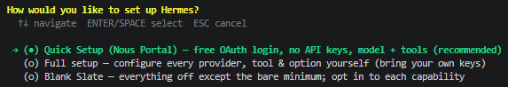
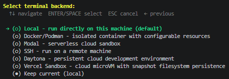
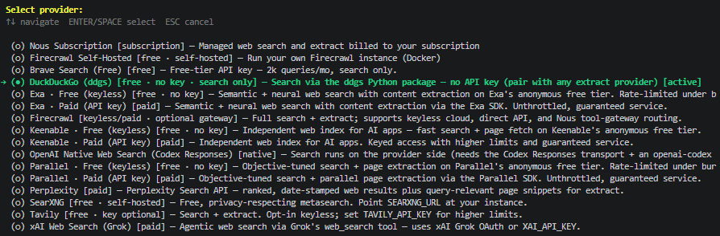
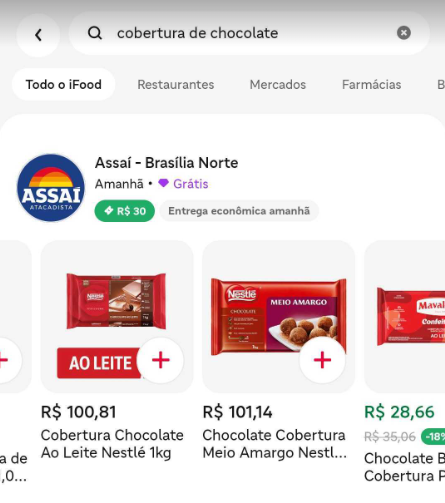
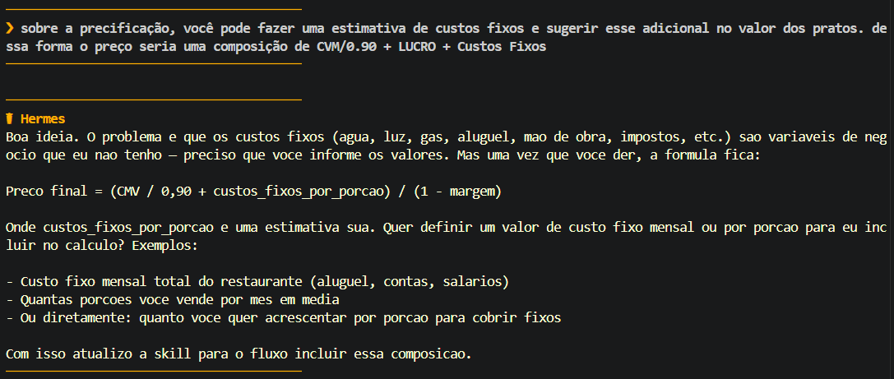

# Sobre o desafio

Considerando apenas sucessos na interação, o fluxo completo de uma interação básica com o agente pode ser resumida em:

1. Consultar a despensa do usuário

2. Buscar uma receita na internet que utilize os ingredientes disponíveis na despensa

3. Conferir o modo de preparo da receita

4. Consultar a memória do agente em busca de informações das habilidades, utensílios e equipamentos previamente informados pelo usuário

5. Perguntar ao usuário se este tem os utensílios, habilidades e equipamentos faltantes da receita (e acrescentar essas novas informações na memória)

6. Informar o custo estimado da receita por meio do cálculo de Custo de Mercadoria Vendida estimado do prato, composto pela "quantidade usada × custo unitário"

7. Sugerir três cenários de preço com base nas regras:

- O usuário paga 10% de taxa sobre o valor do prato no cardápio
- O preço mínimo do prato para o usuário ter lucro é: CVM/0,9
- É esperado que o agente entregue três cenários de preços possíveis (considerando três margens de lucro diferentes) e aguarde a aceitação do usuário

8. Adicionar o prato ao cardápio

Essa interação pode sofrer alterações e não seguir a ordem linear se: 

- A despensa estiver desfalcada (fazendo o agente não encontrar receitas com os ingredientes restantes, travando no passo 2)

- O usuário reprovar as receitas encontradas pelo agente (retornando o fluxo para a etapa 2)

- O usuário não tiver utensílios, habilidades ou equipamentos necessários para a receita (retornando o fluxo ao passo 2)

- Os preços da despensa estiverem desatualizados (travando o fluxo no passo 6)

- O usuário recusar todos os preços sugeridos (travando o fluxo no passo 7)

- O usuário consultar o cardápio ou a despensa, levando a interação para outro fluxo

# Implementação

## Escolhas

### Versão

Para esse projeto, estou utilizando o Hermes versão v0.23.1

### Setup Inicial

Para uma primeira versão, utilizei o setup padrão do Hermes. Especialmente por não conhecer a plataforma, preferi mudar as configurações aos poucos do que configurar tudo de uma vez e perder mais tempo na configuração do que no desafio. 

### Modelo

O modelo escolhido foi o `deepseek-ai/DeepSeek-V4-Flash`. A escolha se deu por ser um modelo treinado e utilizável em português que tem uma janela de contexto de 1M de tokens, que, também, é suportada pela API do hugginface, necessária para o problema, open-source, o que reduz custos na implementação e testes do projeto, consegue lidar bem com documentos estruturados como uma planilha e suporta *tool calling* mesmo que sua latência seja maior do que outras opções disponíveis. Essa decisão foi tomada considerando que o agente irá se comunicar apenas por texto com a Dona Maria.

### Ambiente de desenvolvimento

Como backend, eu escolhi rodar localmente, porque subi uma VM isolada em nuvem. Pensando em escalabilidade e um ambiente produtivo real, eu escolheria uma estratégia de conteinerização com docker e kubernetes para escalar o serviço de acordo com a demanda. 

### Engine de busca 

A engine de busca web escolhida foi o DuckDuckGo por ser gratuita, replicável e não depender de interface gráfica. Ainda, a escolha é orientada em uma decisão de negócio, entendendo que o agente é focado em pequenos comerciantes, existe um foco maior em receitas mais simples ou 'caseiras' e estas são expostas nos resultados de busca (web_search) sem a necessidade de entrarem uma página e extrair informações (web_extract) o que consumiria um volume maior de tokens. A ferramenta de busca do Duck Duck Go permite apenas o uso de web_search e trava requisições com web_extract, essa limitação foi pensada para economia de tokens do modelo reduzindo o processamento dos conteúdos das páginas vindos do web_extract.

### Padronização de medidas

Para garantir que as receitas estejam de acordo com a despensa do usuário (Dona Maria), as quantidades devem ser padronizadas, medidas e o estoque resultante deve ser calculado com base no uso por receita. Assim, criei um documento de conversão de medidas para padronizar quaisquer conversões necessárias, na interpretação de uma receita.

O documento foi escrito com base em conversões padronizadas. As conversões não padronizadas, como 'peso de um dente de alho', 'peso de uma unidade de tomate' ou 'peso de uma unidade de cebola' foram calculados com base em ingredientes presentes na minha própria despensa que foram pesados para agregarem a tabela de conversão. 

Finalmente, a quantidade, em quilos, do ítem "cobertura de chocolate" da despensa da Dona Maria, foi considerado um quilo. Com base no preço de ítens similares disponíveis no iFood Mercado da minha região. 

### Instruções da persona de testes

Na fase de testes, eu assumi que Dona Maria teria as mesmas habilidades e equipamentos que o influenciador Luiz Felipe Alves ([@euluizfelipealves](https://www.instagram.com/euluizfelipealves/)) e repliquei para a persona de Dona Maria por meio de chamada direta ao Hermes, como forma de testar a tool call, atualização e persistência de memória no agente.

A decisão de usar como base a cozinha e habilidades do influenciador Luiz Felipe Alves se deu para utilizar uma fonte terceira de informações evitando viéses no desenvolvimento para experiências pessoais.

### Cálculo de custos

Para uma melhor estimativa de preço cobrado por prato, fiz uma alteração na regra do valor mínimo do prato de `CVM/0.90` para `CVM/0.90 + Custos Fixos`, de forma a gerar valores mais realistas para o cardápio. Dessa forma a precificação fica em:

Preco final = (CMV / 0,90 + custos_fixos_por_porcao) / (1 - margem)

considerando custos fixos da operação (divididos por pratos), como:

- energia elétrica
- aluguel
- água
- gás

O custo fixo tradicionalmente também inclui salários. Como estamos tratando do caso de uso de um restaurante emprocesso de abertura, ainda não são considerados salários na conta de custos operacionais.

### Arquitetura multi-agente

A escolha de uma arquitetura multi-agêntica, forçando o hermes a delegar tarefas específicas para subagentes, para desenvolvimento do desafio se deu para otimizar o uso da janela de contexto do agente com resultados que entregam valor ao usuário. 

Como temos quatro tarefas principais e altamente especializadas:

- Busca na memória
- Conversa com o usuário + orquestração dos agentes
- Busca na internet
- Cálculo de preço

A instrução para cada uma dessas tarefas, se implementadas em um único agente, pode "consumir" contexto demais, levando o agente a ignorar instruções importantes e essenciais para o seu correto funcionamento. Separando as atividades em três agentes (a decisão de unir a tarefa de busca na memória, conversa com o usuário e orquestração dos agentes em um único agente se deu por estas instruções se sobreporem durante a implementação. Para evitar redundância e consumo desnecessário de tokens e demais recursos, essas três tarefas foram delegadas a um único agente).

### Interface gráfica

Para demonstrar as funcionalidades, desenvolvi uma interface gráfica para expor a solução. Nela pensei no fluxo do usuário como um todo:

- A atualização da despensa
- A conversa com o agente com atalhos para facilitar a experiência
- A conferência do cardápio e dos preços
- A conferência dos itens da despensa
- A conferência dos itens comprados
